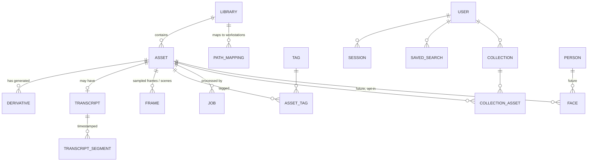

# Data Model (Milestone 0 draft)

System of record: PostgreSQL 16 + pgvector. All derived paths stored **relative
to the data volume**; all original paths stored **relative to the library root**.

## Entity overview

## Tables

### `libraries`
name, root_path (server), storage_type, read_only, include_extensions,
exclude_globs, scan_schedule, watcher_enabled, processing_profile_id,
retention_policy, client/project association, timezone, enabled.
Looking (migration 0034): look_at_ingest — whether the Looker looks at
what arrives in this library, off unless an administrator turns it on — and
look_since, the moment it went on (cleared when it goes off); nothing
older is swept up by it. Set through `PATCH /libraries/{id}` by an
administrator: the box "Look at new footage with AI" on the Libraries page.

### `path_mappings`
library_id, profile_name ("Windows Desktop", "MacBook Pro"), platform, prefix
replacement (`/media/intel` → `Z:\Intel`). Consumed by `/assets/{id}/paths`
and, later, the Premiere panel.

### `assets`
Identity: id (UUID, stable primary identifier — never the path), library_id,
relative_path, filename, extension, mime_type, media_type (image|video|audio),
size, mtime, ctime, first_indexed_at, last_verified_at, content_hash (BLAKE3),
partial_hash (first+last 1 MiB), availability (online|missing|unmounted),
processing_status.
Technical: duration, width, height, fps, video_codec, audio_codec, sample_rate,
channels, bitrate, orientation.
Capture: camera_make/model, lens, focal_length, aperture, shutter, iso,
gps_lat/lon (nullable), captured_at.
Curation: rating, favorite, archived, title, description, custom_fields (JSONB).
Pairing: proxy_of_id (nullable FK to assets, migration 0029) — set on an
editing proxy (Premiere's `Proxies/<stem>_Proxy.<ext>`, the library's
`proxy_pattern`) whose original is catalogued; such a row is out of every
catalogue listing (`catalogued()`) and is decoded on the original's behalf
(ADR-0021).
Looking (migration 0034): look_score (0–100), look_caption, look_reason,
looked_at and looked_by — what a local model made of it, rolled up so
Browse, search and culling can sort by it without a join. A photograph
takes its own look; a clip takes its best-scoring shot's. A score means "a
model has an opinion"; looked_at is set only once every shot of a clip has
been looked at; looked_by is the build-and-question key the looks share, or
"mixed". All empty until something has been looked at.
Indexes: (library_id, relative_path) unique; content_hash; captured_at;
media_type + captured_at; looked_at; tsvector GIN over
filename+title+description.

### Folders (no table)
A folder is a library plus a path relative to its root, `/`-separated with
no slash at either end; `""` is the whole library. A review or a
comparison of a folder takes everything beneath it. Nothing is stored for it: what is in a folder
is worked out from `assets.relative_path` (`media/folders.py`), never by
reading the disk, so a folder path can never reach outside its library.
Names are kept exactly as the scanner wrote them (a trailing space or a
backslash is part of a Mac folder's name). `GET /assets/folders` lists one
level of a library with counts of photographs, clips and what has been
looked at (Browse's Folders view reads it); `look_requests.folder` and a
comparison drawn from a folder hold such a path.

### `derivatives`
asset_id, kind (thumbnail|poster|preview|proxy|editing_proxy|waveform|
extracted_audio|subtitle|transcript_json|scene_thumb|contact_sheet),
relative_path (under data volume), format, width/height, codec, status,
generated_at, size, checksum, expires_at. Unique (asset_id, kind, variant).

### `transcripts`
asset_id, language, language_confidence, model, model_version, processed_at,
full_text, full_text_tsv (GIN), segment_count, diarized, version,
user_corrected.

### `transcript_segments`
transcript_id, start_ms, end_ms, text, speaker (nullable), confidence,
embedding vector(768) HNSW, text_tsv GIN. This is the unit of
"jump to 00:02:17" search results.

### `frames`
asset_id, ts_ms, end_ts_ms, scene_number, thumb relative path, phash,
embedding vector(512) HNSW (CLIP space), caption (nullable), ocr_text
(nullable), labels JSONB with confidences. Images get exactly one row
(ts_ms = 0), unifying image and video-frame vector search in one table.

### `shot_windows` (migration 0028)
One row per stretch of a video where the camera keeps doing one thing,
written by the motion pass from the proxy (`processing/shots.py`): asset_id,
idx, start_ms/end_ms, move, direction, speed (frame widths/s), smooth and
smooth_by_speed (JSON, "25" … "800"), energy and energy_score, source_fps,
features (the mean motion terms, so a move can be re-labelled without a
decode), sun_elevation, light, look (JSON: brightness, saturation, warmth,
contrast, sky), framing and subjects (JSON, from CLIP), analysis_version,
described_at. Rebuilt whole on re-analysis. Descriptors, not tags. The
motion track itself is a derivative of kind `motion` (JSON, 10 Hz).

### `cuts` / `cut_pieces` (migrations 0028, 0036)
Every rough cut built through `build_rough_cut` (or imported from an FCP7
XML, or drafted by the local Editor): title, client, library_id, source
(mcp | import | local), profile, duration_s, piece_count, created_by,
created_at. Pieces: position, asset_id (SET NULL), filename, in_ms/out_ms,
speed, and `shot` — a JSON snapshot of the window the piece came from (move,
light, subjects, smoothness at its speed), so history does not shift when a
clip is re-analysed.

0036 adds versions and where a cut came from. A cut that revises another is
kept beside it, never over it: root_id (the first version's id, NULL on the
first version itself; indexed, no foreign key, so deleting version 1 does
not un-group the rest), parent_id (the cut this one revises; no foreign
key), version (1 + the highest in the family; readers order by version,
then created_at). sent_at is the first download of a local draft's Premiere
file from the Cuts page: until then the draft marks no shot used and is
left out of `recent_cuts` (`nle/shotlist.counts_as_used`); Claude's cuts
and imported timelines count as before. The build that drafted it is kept
as text — model, model_revision, variant, runtime, runtime_version,
prompt_version (NULL on cuts no local model wrote). Pieces gain note: the
piece's reason, written as its marker in the XML (model text when a local
model drafted it, shown only as text).

### `cut_drafts` (migration 0036)
A request to the Editor (a local model) for a rough cut, and how it went; a
draft that succeeded is an ordinary cut with source `local`. state (queued |
running | done | failed | cancelled as stored; "waiting" is read off the
`local_ai_jobs` row), message, title, brief, scope (JSON: the folder or the
ticked clips, with a label), target_s, min_shot_s, max_shot_s, exclude_used,
candidates (JSON: the numbered shot lines the model was offered, by clip and
span — never by a `shot_windows` id), shots_in_scope, clips, answer_text
(what the model wrote, at most 20,000 characters), problems (JSON: what the
check repaired or dropped, in sentences), cut_id (the cut it became; SET
NULL), revises_cut_id and job_id (no foreign keys: history, and job rows may
be pruned), origin (web | chat), the six provenance names, seconds, demo,
requested_by (SET NULL), created_at, started_at, finished_at. Indexed on
cut_id (deleting a cut has to find the draft that became it) and on
created_at. A draft is refused before any row is written when its footage
holds more shot windows than one shot search reads (20,000), so
shots_in_scope never describes a sample.

### `chat_conversations` / `chat_messages` / `chat_tool_calls` (migration 0031)
The chat panel ([chat.md](chat.md)). A conversation is private to its
owner: model, whether pictures are sent, the hash of the instructions and
tool list it started with (sent unchanged on every later request), state
(idle | running | awaiting_confirmation) with a heartbeat, how the last turn
ended, spend and tokens. Messages: seq, role, and `content` — the content
blocks exactly as sent or received (JSON, not JSONB, which would reorder
keys), a picture replaced by a reference to its file. Tool calls: what
Claude asked for, whether it needed a yes, and its state (running | ran |
pending | approved | declined | failed), who decided and when, the result.

### `local_models` / `local_ai_roles` / `local_ai_jobs` (migration 0032)
Local AI models ([local-models.md](local-models.md)). `local_models`: one
build of a Hugging Face model — repo_id (and repo_key, casefolded), the
commit it was fetched at, variant (a build inside a repository; "" when
there is one), publisher and the chain it was built from (approval is judged
again from it on every use), licence, gated, runtime, what it takes, the
exact files with their checksums, size, estimated and measured memory, state
(downloading | installed | incomplete). No path is stored. Unique (repo_key,
revision, variant). `local_ai_roles`: one row per role (looker | editor),
the model that has it and the one waiting for its copy to finish.
`local_ai_jobs`: the work table behind the `local_ai` lane — kind, subject,
priority, state (queued | waiting | running | done | failed | cancelled),
not_before, progress, message, payload and result, cancel_requested, a
heartbeat, and for a job that asked a model the five provenance columns
(model, model_revision, runtime, runtime_version, prompt_version). The queue
only carries a wake-up; the row is the job.

### `local_ai_comparisons` and its three tables (migration 0033)
Compare ([local-models.md](local-models.md#comparing-models),
[ADR-0024](adr/0024-compare-measures-agreement-not-quality.md)).
Everything a model is shown is frozen here when a comparison is made.
- `local_ai_comparisons`: name, source_kind (folder | listing | cuts |
  comparison) and the source as asked, what (shots | photos | both), size,
  stills (1 | 3), the seed that drew it, prompt_version, the vocabulary as
  the models are told it, the counted cuts, the counts of the sample and its
  truth, truth_at, and the owner's decision (verdict "" | chosen | none, the
  chosen column, a note, who and when).
- `local_ai_comparison_items`: position, kind (shot | photo), asset_id (SET
  NULL) and the asset's library, path and name as they were, start_ms /
  end_ms for a shot (never a `shot_windows` id), the measured facts and the
  sentence each model is told, the moments of the frozen pictures (files
  under `<data_dir>/compare/<comparison id>/`), the tags a person had said
  yes and no to, and whether the shot was used and in which cuts.
- `local_ai_comparison_models`: one column per model — model_id (SET NULL:
  a removed model keeps its column, read as no longer installed), the build as text
  (model, model_revision, variant), runtime and version, prompt_version,
  state (queued | running | waiting | done | stopped | failed) and its
  sentence, the job running it, answers stored and failed, load seconds,
  where it loaded from, the most memory reported and how it was measured.
- `local_ai_comparison_answers`: one per column and item (unique): ok, the
  problem (bad_answer | died | timeout | runtime_error | no_picture), every
  proposed tag with its confidence and whether it is a catalogue word,
  caption, score, reason, seconds, attempts, memory, and what the model wrote
  when it took a second try or failed.
Nothing here is read back into the catalogue. Removing a comparison removes
its items, columns and answers (CASCADE). An item's position is unique
within its comparison (`uq_local_ai_comparison_items_position`), and a
build (model, model_revision, variant) has one column per comparison
(`uq_local_ai_comparison_models_build`). Indexed on the comparison's
created_at, on each child table's comparison_id or entry_id, on the item's
asset_id and the column's model_id, and on the answer's item_id.

### `look_requests` / `looks` (migration 0034)
Looking: a local model looking at the catalogue
([local-models.md](local-models.md#reviewing-a-folder-on-request)).

`look_requests`: a review somebody asked for, and how far it got.
library_id (CASCADE), folder ("" is the whole library; always "and
everything beneath it"), run_when (now | tonight), redo, prepare (make
clips ready first), model_id and model_name (the model asked for; NULL:
whoever is the Looker when it runs; no foreign key), state (active | done |
failed | cancelled) and message, its closing sentence. The counters a page
shows: done, total, failed (items: photographs and shots), tags_suggested,
new_tags, held (suggestions held back), stills_only (clips judged from one
still). Making clips ready: prep_state ("" | running | done), prep_total,
prep_ready, prep_gave_up, prep_queued_at, prep_progress_at. look_job_id and
prepare_job_id name its `local_ai_jobs` rows without a foreign key, because
those may be pruned and the review outlives them. requested_by (SET NULL),
created_at, started_at, finished_at. Three parties write a row (the look
job, the make-ready job, and Cancel), each by naming its columns, and every
write that ends a review applies only while it is still active, so a Cancel
stands. Indexed on library_id and on (state, created_at).

`looks`: the ledger of "looked at" — one row per attempt at a photograph or
a shot. asset_id (CASCADE), start_ms and end_ms (both NULL: the whole item,
a photograph or a clip judged from one still; otherwise the shot's times —
never a `shot_windows` id, which a re-analysis deletes), ok (false: a try
that produced nothing usable, with note saying why, so one review never
asks about the same bad file twice), current (at most one current,
successful look per photograph or shot, kept so by the one writer,
`looking/store.py`; a re-analysis that moves a shot's times stops its look
counting, and that shot is looked at again), score (0–100), caption,
reason, answer (JSON: the cleaned answer and what became of each tag it
proposed, in words: suggested, a new tag, strengthened, held back and why,
and so on),
seconds, demo (the demonstration's made-up model said it), request_id (the
review that asked, SET NULL; NULL also means looking at what arrived), and
the build and question as text: the five provenance columns plus variant,
and `key` = `<repo>@<revision>[/<variant>]#<prompt version>`, which is what
"already looked at by this build and question" compares. Nothing is pruned;
an asset's looks go with the asset. Indexed on (asset_id, start_ms,
end_ms), (model, created_at) and request_id.

The same migration adds, all nullable or defaulted so no row is rewritten:
the roll-up on `assets` (look_score, look_caption, look_reason, looked_at —
indexed, `ix_assets_looked_at` — and looked_by); the per-library switch on
`libraries` (look_at_ingest, look_since); and on `asset_tags` the look that
proposed a suggestion and the moment in the clip it is about (look_id, SET
NULL; at_ms). `asset_tags.look_id` has its own index,
`ix_asset_tags_look_id`: deleting an asset deletes its looks, and each
deletion has to find the tags pointing at that look to clear them, which
without the index is a scan of every tag row per look.

### `clip_looks` / `listing_edit_suggestions` (migration 0035)
Colour. `clip_looks`: at most two rows per clip, `suggested` (written only by
the local-AI lane) and `chosen` (written only by the API), each with its
source (model | learned | none | custom), the LUT-carried sliders, what was
measured on the reference still (and still_ts_ms, the moment it was taken
from), the slider keys a LUT cannot carry, the still's picture features
(what the video look learns from), the model's reason, the build as text,
and decided_by, created_at and updated_at. Unique (asset_id, kind), so a
suggestion arriving can never overwrite a choice, nor the reverse; indexed
on asset_id and on kind (the video look reads every chosen row). The LUT
itself is never stored: the same recipe writes the same `.cube` every time.
`listing_edit_suggestions`: what a local model proposes for one photograph
of a listing (straightening, whether the sky is worth replacing, caption,
file name) until a person applies or dismisses it (state proposed | applied
| dismissed, the edit version Apply wrote, who decided and when), with the
build as text. One per listing item (unique item_id): asking again replaces
it. Both carry demo, true when the demo's made-up model said it.
A proposal's state becomes applied when auto-edit's `local` mode writes the
edit; applied_version is the `asset_edits.version` it wrote, and
decided_at / decided_by say when and by whom (the person who pressed Apply,
or Dismiss). created_at is when the model made the proposal, and asking
again rewrites it: the listing page is given it as `made_at`, sends it back
with Apply, and a photograph whose proposal has been made again since it
was shown is left out of that Apply (compared to the second, in UTC).
Columns: listing_id, item_id, asset_id (each CASCADE), rotate, keystone,
sky_worth_replacing, caption, slug, note. Indexed on listing_id and on
asset_id (deleting an asset has to find its rows).

Every table that records what a model said carries the same five
provenance columns as text — model, model_revision, runtime,
runtime_version, prompt_version. The answer tables (`looks`, `clip_looks`,
`listing_edit_suggestions`, `local_ai_comparison_models`) also carry
variant, part of what makes a build: "" for a repository with one build,
while two quantisations of one GGUF repository at one commit are two
builds. None depends on a row in `local_models`: removing a model never
changes what it once said.

### `tags` / `asset_tags`
tags: name, slug, and what the learner has learned (prototype, threshold
and its reason, example count, whether suggestions are on)
([tagging.md](tagging.md)).
asset_tags: asset_id, tag_id (unique together), source (manual | suggested
| confirmed | rejected), confidence, created_by, and for a suggestion its
origin — who proposed it: clip (the learner), claude (the API reviewer),
mcp (Claude through the connector) or local (a model on this server, a
look). A local suggestion also carries look_id (the look that proposed it:
which shot, which build, what else the model said; SET NULL, so removing a
look never removes a tag) and at_ms (the moment in a clip it is about)
(migration 0034).

### `jobs`
id, asset_id, type, queue, status, priority, attempts, worker, created/started/
finished_at, progress, error_summary, log_excerpt, model_version, next_retry_at.
Mirrors Celery state into Postgres so the dashboard needs no broker access.

### `users` / `sessions`
users: email, password_hash (argon2id), role (admin|user|readonly), totp_secret
(nullable, encrypted), disabled, created_at, last_login.
sessions: opaque token hash, user_id, expires_at, ip, user_agent, revoked.

### `saved_searches`, `collections`, `collection_assets`, `audit_log`, `settings`
Straightforward; `settings` (the table is `app_settings`) is a typed
key-value table for wizard-managed config (remote access mode, processing
schedule, concurrency caps). Its `looking` row holds whether a local model
may propose words not yet in the vocabulary (new_tags), and how many stills
it is shown per shot (stills_per_shot, 3 or 1); an administrator changes
both through `PUT /api/v1/looks/settings`, from the card "What the Looker
does" on the AI models page. Its `demo_seed` row is the dev seed's note of what it has
added to a review catalogue, so that nothing is added twice.

### Faces (schema reserved, feature post-MVP, admin opt-in)
`people` (name, user-confirmed) and `faces` (asset_id, frame_id, bbox,
embedding, person_id nullable, cluster_id). Biometric rows are hard-deleted on
disable — see threat model §privacy.

## Embedding dimension note

Vector columns are created per model family; changing embedding models creates
a new column/index and a background re-embed job rather than an in-place
overwrite, so old and new vectors can coexist during migration
(model + version recorded on every row).
